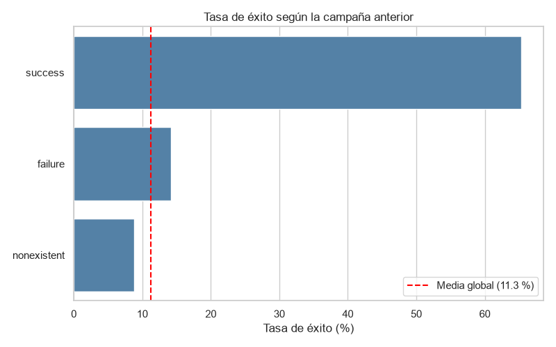
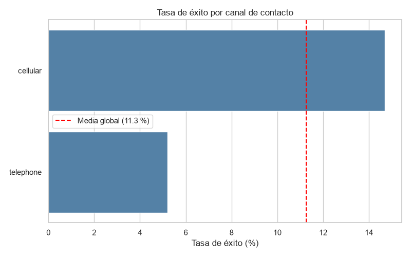
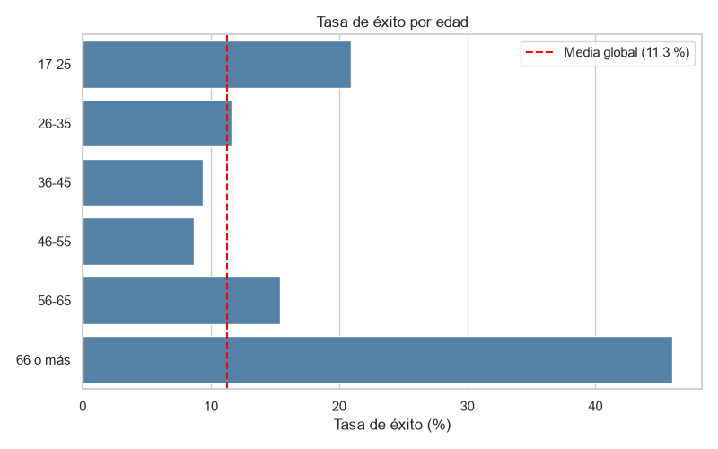
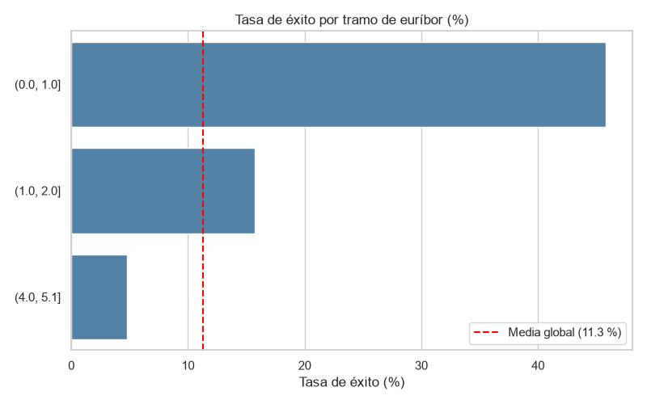

# 📊 Análisis exploratorio de una campaña de marketing bancario

¿Qué clientes contratan un depósito a plazo?

## 📖 Descripción

Los datos son de un banco portugués que llama por teléfono a sus clientes para ofrecerles un depósito a plazo. El objetivo del análisis es averiguar qué características tienen los clientes que contratan el depósito, para que el banco pueda centrar sus llamadas en los clientes con más posibilidades.

Para ello he hecho un análisis exploratorio de datos (EDA) con Python y Pandas: limpieza y transformación de los datos, unión de los dos archivos, estadística descriptiva, correlaciones y gráficos.

### Datos

- `bank-additional.csv`: una fila por cada cliente al que se llamó en la campaña. Incluye datos del cliente (edad, profesión, estado civil...), datos de la llamada, indicadores económicos del momento y si contrató o no el depósito. Tiene 43.000 filas y 24 columnas.
- `customer-details.xlsx`: datos de los clientes del banco, como ingresos, número de hijos, fecha de alta y visitas a la web. Está repartido en 3 hojas (2012, 2013 y 2014) según el año en que el cliente se dio de alta. En total son 43.170 clientes y 7 columnas.

## 🗂️ Estructura del proyecto

```
EDA-MARKETING-BANCARIO/
├── data/
│   ├── raw/          # datos originales, sin modificar
│   └── processed/    # datos limpios y unidos
├── images/           # gráficos del análisis
├── notebooks/
│   ├── 01_carga_exploracion.ipynb       # primer vistazo y problemas encontrados
│   ├── 02_limpieza.ipynb                # limpieza, unión y guardado
│   └── 03_analisis_visualizacion.ipynb  # análisis y gráficos
├── src/
│   └── soporte.py    # funciones reutilizables
├── requirements.txt
└── README.md
```

## 🛠️ Instalación y requisitos

El proyecto usa Python 3.13 y estas librerías:

- pandas
- openpyxl (para leer el Excel)
- matplotlib
- seaborn

Para instalarlo:

```bash
git clone https://github.com/gemitue32/EDA-MARKETING-BANCARIO.git
cd EDA-MARKETING-BANCARIO
python -m venv .venv
.venv\Scripts\activate
pip install -r requirements.txt
```

Después hay que ejecutar los notebooks en orden: `01`, `02` y `03`. El notebook 02 crea el archivo limpio que usa el 03.

## 🔎 Pasos seguidos

**1. Exploración** ([01_carga_exploracion.ipynb](notebooks/01_carga_exploracion.ipynb))

Antes de cambiar nada, revisé los datos y apunté los problemas en un diario de hallazgos. Los principales:

- Algunos números usaban coma decimal (`93,994`) y se leían como texto.
- La fecha tenía el mes escrito en español (`2-agosto-2019`).
- Había una columna `Unnamed: 0` que era solo el índice, y dos columnas de coordenadas que no eran de Portugal sino de Estados Unidos.
- Faltaban las columnas de mes y año que pide el enunciado.
- Había valores nulos en 10 columnas, desde el 0,2 % hasta el 21,5 %.

**2. Limpieza** ([02_limpieza.ipynb](notebooks/02_limpieza.ipynb))

Algunas decisiones importantes:

| Problema | Qué hice |
|---|---|
| Coma decimal | Cambiar la coma por punto y convertir a número |
| Fecha en español | Traducir los meses con un diccionario, convertir a fecha y crear `contact_month` y `contact_year` |
| Nulos en textos (profesión, estado civil, estudios) | Rellenar con `unknown` para no inventar categorías |
| Nulos en la edad | Rellenar con la mediana (38), porque la media sube por los clientes muy mayores |
| Nulos en el euríbor | Rellenar con la mediana de su periodo económico, porque el euríbor apenas cambia dentro de un mismo periodo |
| Nulos en hipoteca y préstamos | No rellenar: sería inventar el dato |
| Excel en 3 hojas | Unirlas en una tabla y después unirla con las llamadas por el ID del cliente |

El resultado se guarda en `data/processed/bank_customers_clean.csv`: 43.000 llamadas y 28 columnas.

**3. Análisis** ([03_analisis_visualizacion.ipynb](notebooks/03_analisis_visualizacion.ipynb))

Estadística descriptiva, tasa de éxito por grupos, correlaciones y gráficos. Los resultados están en el siguiente apartado.

## 📊 Resultados y conclusiones

De las 43.000 llamadas, solo el **11,3 %** acabó en contratación, es decir, una de cada nueve.

**1. Quien ya contrató antes vuelve a contratar**

Los clientes que contrataron en una campaña anterior vuelven a contratar en el **65 %** de los casos, casi 6 veces más que la media. Es el dato que más diferencia marca.



**2. Se contrata casi 3 veces más por móvil que por fijo**

Por móvil contrata el 14,7 % de los clientes y por fijo, el 5,2 %.



**3. Los mayores y los jóvenes contratan más**

Los mayores de 65 años contratan en el **46 %** de los casos y los jóvenes de 17 a 25 años, en el 21 %. Las edades intermedias se quedan por debajo de la media. Por profesión pasa lo mismo: estudiantes (31 %) y jubilados (25 %) son los que más contratan.



**Otros resultados**

- **Insistir no ayuda**: los clientes que contratan necesitaron menos llamadas (2,1 de media) que los que no (2,6).
- **El contexto económico influye mucho**: con el euríbor por debajo del 1 % contrató el 46 % de los clientes, y por encima del 4 %, solo el 5 %. El banco no puede controlarlo, pero sí tenerlo en cuenta al planificar las campañas.
- **Los ingresos, los hijos y las visitas a la web no influyen**: son prácticamente iguales en los clientes que contratan y en los que no.
- **No hay meses mejores que otros**: la tasa de éxito está entre el 10 % y el 12 % todos los meses.



**¿Para qué le sirve al banco?**

Si el banco quiere mejorar los resultados, debería empezar por llamar a los clientes que ya contrataron antes, usar el móvil y prestar más atención a los clientes mayores y jóvenes. En cambio, insistir con muchas llamadas al mismo cliente no parece dar resultado.

**Limitaciones**

Estos datos son históricos: muestran qué grupos contratan más, pero no demuestran la causa. Por ejemplo, los clientes llamados por móvil pueden ser distintos en otras cosas. Además, la duración de la llamada es muy distinta entre quien contrata y quien no, pero solo se conoce cuando la llamada termina, así que no sirve para decidir a quién llamar.

## 🔄 Próximos pasos

Para comprobar si estas diferencias son la causa, se podrían hacer tests A/B en la próxima campaña. Un test A/B solo sirve para lo que el banco controla (el canal, la oferta, el número de llamadas), no para las características del cliente como la edad.

- **Canal**: repartir al azar a los clientes entre llamada por móvil y por fijo y comparar cuántos contratan.
- **Número de llamadas**: limitar las llamadas por cliente en un grupo y compararlo con el procedimiento actual.
- **Oferta por edad**: dentro de los mayores de 65 y de los jóvenes, probar una oferta adaptada a su perfil frente a la llamada habitual.

## 🤝 Contribuciones

Las sugerencias son bienvenidas. Si quieres proponer una mejora, puedes abrir una issue o un pull request.

## ✒️ Autora

- Gema Moreno - [@gemitue32](https://github.com/gemitue32)

Proyecto del módulo Python for Data del curso de Data Analytics de ThePower.
